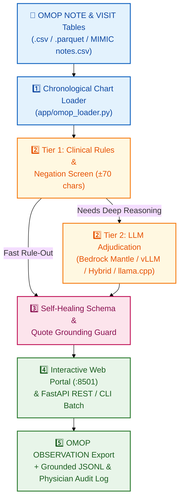
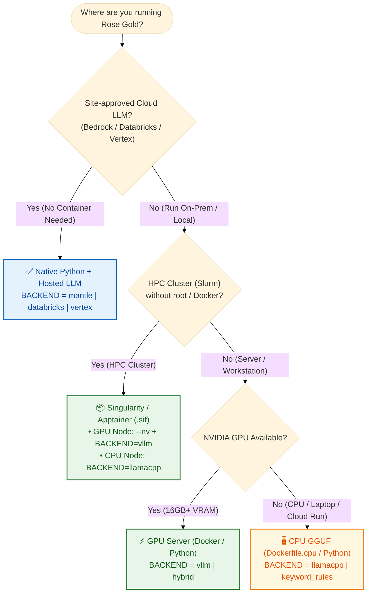
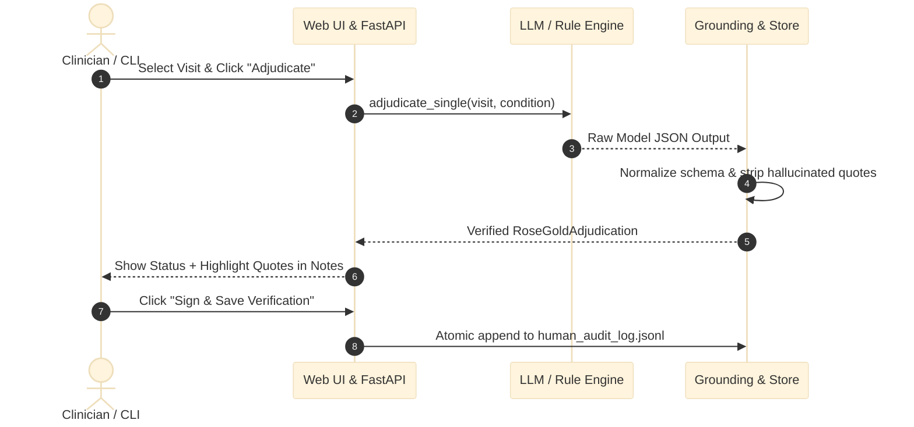

# 🩺 Rose Gold: Clinical LLM Chart Adjudication Suite

**Turnkey OMOP CDM (`NOTE` + `VISIT_OCCURRENCE`) clinical phenotyping and evidence-grounded chart adjudication for hospital networks and multi-center research consortia.**

🌐 **Live Interactive Web Portal:** [https://rosegold-eoohrvwf7q-uc.a.run.app](https://rosegold-eoohrvwf7q-uc.a.run.app)

---

## Why Rose Gold?

- **Evidence-Grounded Adjudication**: Produces structured `RoseGoldAdjudication` labels (`CONFIRMED_POSITIVE`, `SUSPECTED_PROBABLE`, `CONFIRMED_NEGATIVE`, `INDETERMINATE_INSUFFICIENT_DATA`) with **verbatim clinical quotes**, Note IDs, dates, chain-of-thought rationales, and calibrated `[0.0, 1.0]` confidence scores.
- **Anti-Hallucination Verification**: Automatically verifies every LLM-cited quote against the patient's chart (`verify_and_ground_adjudication`), strips ungrounded hallucinations, and normalizes malformed LLM JSON outputs.
- **Flexible Site Deployment (7 Backends, Container Optional)**:
  - **No Container / BYO Hospital LLM**: Native Python calling **AWS Bedrock Mantle**, **Databricks Model Serving**, or **Google Vertex AI Gemini**.
  - **On-Premises GPU**: High-throughput **vLLM** (`Llama-3.1-8B`, `Llama-3.3-70B-AWQ`, `Gemma-2-9B`) or **Two-Tier Hybrid Cascade** (`Rules + Muse-30B`).
  - **Zero-GPU CPU**: Quantized 4-bit **`llama.cpp` GGUF** (`Llama-3.2-3B-Instruct`) or instant **Deterministic Clinical Rules** (`keyword_rules`).

---

## 🧭 Table of Contents

1. [⚡ 60-Second Quick Start](#-60-second-quick-start)
2. [🗺️ Visual Architecture & Decision Guide](#️-visual-architecture--decision-guide)
   - [Diagram 1: End-to-End Adjudication Pipeline](#1-end-to-end-adjudication-pipeline)
   - [Diagram 2: Which Execution Path Fits Your Site?](#2-which-execution-path-fits-your-site)
   - [Diagram 3: Request & Evidence Grounding Sequence](#3-request--evidence-grounding-sequence)
3. [🏆 Clinical Benchmark](#-clinical-benchmark)
4. [🔌 Model Execution Backends (Copy-Paste Setup)](#-model-execution-backends-copy-paste-setup)
5. [🖥️ Using Rose Gold: Web Portal, CLI & REST API](#️-using-rose-gold-web-portal-cli--rest-api)
6. [🚀 Deployment Topologies (Docker, Singularity/HPC, Cloud Run, Air-Gapped)](#-deployment-topologies-docker-singularityhpc-cloud-run-air-gapped)
7. [📋 OMOP CDM Data Contract & Custom Phenotypes](#-omop-cdm-data-contract--custom-phenotypes)
8. [⚙️ Environment Variables Reference](#️-environment-variables-reference)
9. [🔒 Security & Production Hardening](#-security--production-hardening)
10. [❓ Troubleshooting & FAQ](#-troubleshooting--faq)

---

## ⚡ 60-Second Quick Start

### Step 1: Clone & Install (Python 3.11+)

```bash
git clone https://github.com/x1jiang/rosegold.git
cd rosegold

python3 -m venv .venv
source .venv/bin/activate
pip install -r requirements.txt
```

### Step 2: Choose How to Run (Pick One)

#### Option A — Instant Local Demo (Zero GPU, Zero Model Download)
Uses the built-in deterministic clinical rule engine (`keyword_rules`) on the bundled 20-visit synthetic OMOP cohort:
```bash
export ROSEGOLD_LLM_BACKEND="keyword_rules"
export ROSEGOLD_ALLOW_MOCK="1"
./start_services.sh
```

#### Option B — Local CPU LLM (`llama.cpp` 4-Bit GGUF, No GPU Needed)
Automatically downloads and runs `Llama-3.2-3B-Instruct-Q4_K_M.gguf` (~2 GB) on CPU:
```bash
export ROSEGOLD_LLM_BACKEND="llamacpp"
export ROSEGOLD_MODEL_DIR="./models"
./start_services.sh
```

#### Option C — Hospital-Approved Cloud LLM (AWS Bedrock Mantle / Databricks)
No local weights, no Docker, and no Singularity required. Calls your institution's approved endpoint over HTTPS:
```bash
export ROSEGOLD_LLM_BACKEND="mantle"
export AWS_REGION="us-west-2"
export AWS_BEARER_TOKEN_BEDROCK="your-bedrock-api-key"
export ROSEGOLD_OPENAI_MODEL="your-approved-model-id"
./start_services.sh
```

#### Option D — Local NVIDIA GPU (`vLLM`)
```bash
export ROSEGOLD_LLM_BACKEND="vllm"
export ROSEGOLD_MODEL_NAME="meta-llama/Llama-3.1-8B-Instruct"
export HF_TOKEN="hf_..."
./start_services.sh
```

### Step 3: Open the Portal or Run a CLI Batch

- **Interactive Web Portal**: [http://localhost:8501](http://localhost:8501)
- **Swagger REST API Docs**: [http://localhost:8000/docs](http://localhost:8000/docs)
- **Offline CLI Batch**:
  ```bash
  python -m app.adjudicator \
    --notes_path data/synthetic_notes.csv \
    --visits_path data/synthetic_visits.csv \
    --target_condition "Sepsis / Septic Shock" \
    --output_path outputs/rose_gold_adjudications.csv
  ```

---

## 🗺️ Visual Architecture & Decision Guide

### 1. End-to-End Adjudication Pipeline



---

### 2. Which Execution Path Fits Your Site?

Use this decision tree to pick the right backend for your hospital or research environment:



---

### 3. Request & Evidence Grounding Sequence

Every adjudication passes through schema normalization and anti-hallucination chart verification before reaching the clinician or output tables:



---

## 🏆 Clinical Benchmark

Empirical evaluation on inpatient clinical encounters across 4 consensus phenotypes (*Sepsis / Septic Shock*, *Acute Ischemic Stroke*, *Acute Respiratory Distress Syndrome*, and *Acute Kidney Injury*):

| Model Architecture | Paradigm | Accuracy | Cohen's $\kappa$ | Sensitivity | Specificity | False Pos | False Neg | Avg Latency | PHI Boundary |
| :--- | :--- | :---: | :---: | :---: | :---: | :---: | :---: | :---: | :--- |
| **RoseGold Hybrid (Rules + Muse-30B)** | **Two-Tier Cascade** | **93.8%** | **0.875** | **87.5%** | **100.0%** | **0** | **1** | **0.66s** | **100% On-Premises** |
| **Standalone Frontier Cloud LLM** | Direct Cloud API | **81.2%** | **0.625** | **62.5%** | **100.0%** | **0** | **3** | **2.37s** | External Cloud API |

---

## 🔌 Model Execution Backends (Copy-Paste Setup)

Set `ROSEGOLD_LLM_BACKEND` to select your execution engine. When a real LLM backend is configured, Rose Gold **fails closed** (`HTTP 503`) rather than silently substituting keyword heuristics unless `ROSEGOLD_ALLOW_MOCK=1` is set.

| `ROSEGOLD_LLM_BACKEND` | Engine | Hardware Required | Best For |
| :--- | :--- | :--- | :--- |
| `mantle` / `bedrock` | Amazon Bedrock Mantle | None (HTTPS API) | **Recommended no-container hospital path** |
| `databricks` / `openai` | OpenAI-Compatible Hosted | None (HTTPS API) | Sites with Databricks Serving or internal LLM gateways |
| `vertex` / `gemini` | Google Vertex AI Gemini | None (HTTPS API) | GCP healthcare environments under HIPAA BAA |
| `vllm` | vLLM Guided Decoding | NVIDIA GPU (16–80 GB VRAM) | High-throughput local GPU servers |
| `hybrid` | Rules + Muse-Glimmer-30B | Internal GPU Endpoint | Highest accuracy (93.8%) & sub-second screening |
| `llamacpp` | `llama.cpp` 4-Bit GGUF | CPU (4+ cores, 8 GB RAM) | Laptops, CPU-only servers, Cloud Run, CPU HPC nodes |
| `keyword_rules` | Deterministic Clinical Rules | Any CPU (< 1 GB RAM) | Instant offline testing, CI/CD, rule baseline |

### Backend 1: Hospital-Approved Hosted LLMs (Bedrock Mantle / Databricks)

Sites with an IT-approved LLM endpoint do **not** need Docker, Singularity, or local GPU weights. Copy [`configs/site.env.example`](configs/site.env.example) and verify your setup (secrets are automatically redacted):

```bash
# Amazon Bedrock Mantle (OpenAI-compatible Chat Completions)
export ROSEGOLD_LLM_BACKEND="mantle"
export AWS_REGION="us-west-2"
export AWS_BEARER_TOKEN_BEDROCK="your-bedrock-api-key"
export ROSEGOLD_OPENAI_MODEL="your-approved-mantle-model"

# Verify configuration (redacts tokens)
python -m app.hosted_llm

# Run batch adjudication
python -m app.adjudicator --backend mantle \
  --notes_path data/synthetic_notes.csv \
  --visits_path data/synthetic_visits.csv \
  --target_condition "Sepsis / Septic Shock"
```

<details>
<summary><b>Click to expand: Databricks Model Serving & Native Bedrock Converse</b></summary>

```bash
# Databricks Model Serving
export ROSEGOLD_LLM_BACKEND="databricks"
export DATABRICKS_HOST="https://YOUR-WORKSPACE.azuredatabricks.net"
export DATABRICKS_TOKEN="dapi..."
export ROSEGOLD_OPENAI_MODEL="your-serving-endpoint"

python -m app.adjudicator --backend databricks \
  --notes_path data/synthetic_notes.csv \
  --visits_path data/synthetic_visits.csv
```

```bash
# Native AWS Bedrock Runtime Converse (requires: pip install -r requirements-bedrock.txt)
export ROSEGOLD_LLM_BACKEND="bedrock_converse"
export AWS_REGION="us-west-2"
export ROSEGOLD_BEDROCK_MODEL="anthropic.claude-3-5-sonnet-20241022-v2:0"
```
</details>

---

### Backend 2: Local GPU with vLLM (Single or Multi-GPU)

```bash
export ROSEGOLD_LLM_BACKEND="vllm"
export HF_TOKEN="hf_your_token"

# Single GPU (e.g., L4, A10G, RTX 4090, A100)
python -m app.adjudicator \
  --notes_path data/synthetic_notes.csv \
  --visits_path data/synthetic_visits.csv \
  --model_name "meta-llama/Llama-3.1-8B-Instruct" \
  --tensor_parallel_size 1 \
  --max_model_len 32768

# Multi-GPU Tensor Parallelism (4x A100/H100 with FP8 quantization)
python -m app.adjudicator \
  --notes_path data/synthetic_notes.csv \
  --visits_path data/synthetic_visits.csv \
  --model_name "meta-llama/Llama-3.1-8B-Instruct" \
  --tensor_parallel_size 4 \
  --quantization fp8 \
  --max_model_len 65536
```

---

### Backend 3: Local CPU with `llama.cpp` (Zero GPU)

```bash
export ROSEGOLD_LLM_BACKEND="llamacpp"
export ROSEGOLD_LLAMA_REPO="bartowski/Llama-3.2-3B-Instruct-GGUF"
export ROSEGOLD_LLAMA_GGUF="Llama-3.2-3B-Instruct-Q4_K_M.gguf"
export ROSEGOLD_MODEL_DIR="./models"

python -m app.adjudicator \
  --notes_path data/synthetic_notes.csv \
  --visits_path data/synthetic_visits.csv \
  --target_condition "Acute Ischemic Stroke"
```

---

### Backend 4: Two-Tier Hybrid Cascade (`Rules + Muse-30B`)

```bash
export ROSEGOLD_LLM_BACKEND="hybrid"
export ROSEGOLD_MUSE_URL="https://muse.your-hospital.internal/v1/completions"
export ROSEGOLD_MUSE_MODEL="Muse-Glimmer-30B"
export ROSEGOLD_MUSE_API_KEY="optional-bearer-token"

python -m app.adjudicator \
  --notes_path data/synthetic_notes.csv \
  --visits_path data/synthetic_visits.csv \
  --target_condition "Sepsis / Septic Shock"
```

For runs that require Muse to adjudicate every case, set
`ROSEGOLD_HYBRID_REQUIRE_LLM=1`. This mode sends the rule screen and source
observations to Muse's structured chat endpoint, preserves indeterminate results,
and retains only exact source quotes. The rule screen is a candidate for Muse to
review. Model failures produce an indeterminate result with a `hybrid:llm_failed`
backend tag. The default hybrid cascade continues to use its existing fast screen.
The endpoint must serve the configured model on `/v1/chat/completions`.

---

### Backend 5: Google Vertex AI Gemini

```bash
export ROSEGOLD_LLM_BACKEND="vertex"
export GOOGLE_CLOUD_PROJECT="your-gcp-project-id"

python -m app.adjudicator \
  --notes_path data/synthetic_notes.csv \
  --visits_path data/synthetic_visits.csv \
  --target_condition "Acute Respiratory Distress Syndrome (ARDS)"
```

---

## 🖥️ Using Rose Gold: Web Portal, CLI & REST API

### 1. Interactive Web Portal (`Streamlit` on `:8501`)

Launch both FastAPI (`:8000`) and the Streamlit clinician portal (`:8501`):
```bash
./start_services.sh
```

**Key Portal Features:**
- **Queue Filter & One-Click Navigation**: Filter encounters by `All Encounters`, `Unreviewed Only`, `Adjudicated Positive`, or `Adjudicated Negative`, and step through visits with **⬅️ Prev** and **Next ➡️** buttons.
- **Inline Evidence & Keyword Highlighting**: Automatically highlights verbatim LLM evidence quotes (in gold) and search keywords (in blue) directly inside the chronological patient note cards.
- **Built-in & Custom Phenotypes**: Choose from Sepsis, Acute Ischemic Stroke, ARDS, AKI, or select **`Custom Phenotype...`** to adjudicate any clinical condition (e.g., *Pulmonary Embolism*, *Decompensated Heart Failure*) with custom consensus criteria.
- **Physician Verification & Concordance Matrix**: Sign off or override LLM labels to compute live **Cohen's $\kappa$**, sensitivity, specificity, PPV, NPV, and exportable calibration audit logs.

---

### 2. CLI Batch Adjudication (`app.adjudicator`)

Process thousands of visits offline with **automatic JSONL checkpoint resumption** (if interrupted, re-running the same command skips already-completed `visit_occurrence_id`s):

```bash
python -m app.adjudicator \
  --notes_path data/synthetic_notes.csv \
  --visits_path data/synthetic_visits.csv \
  --output_path outputs/rose_gold_adjudications.csv \
  --target_condition "Sepsis / Septic Shock" \
  --chunk_size 50
```

**Generated Outputs:**
| File | Format | Description |
| :--- | :--- | :--- |
| `outputs/rose_gold_adjudications.csv` | CSV | Tabular adjudications (`phenotype_status`, `confidence_score`, `clinical_rationale`). |
| `outputs/rose_gold_adjudications.parquet` | Parquet | Columnar file for analytics pipelines. |
| `outputs/rose_gold_adjudications.jsonl` | JSONL | Full nested payload including `key_evidence` quotes (used for checkpoint resumption). |
| `outputs/omop_observation_adjudications.csv` | OMOP CSV | Standard OMOP CDM v5.4 `OBSERVATION` table mapped to SNOMED-CT concepts. |

---

### 3. FastAPI REST Service (`:8000`)

#### Health & Readiness Probes
- `GET /health` — Liveness probe (`200 OK` when process is up; summarizes active backend).
- `GET /ready` — Readiness probe (`200 OK` only when the configured LLM backend is ready to serve; `503` with `Retry-After` while loading).

#### Single-Visit Adjudication (`POST /api/adjudicate/single`)
```bash
curl -X POST http://127.0.0.1:8000/api/adjudicate/single \
  -H "Content-Type: application/json" \
  -d '{
    "visit_occurrence_id": 20001,
    "target_condition": "Sepsis / Septic Shock"
  }'
```

#### Ad-Hoc Note Text Adjudication (Python)
```python
import requests

resp = requests.post(
    "http://127.0.0.1:8000/api/adjudicate/single",
    json={
        "person_id": 1001,
        "target_condition": "Pulmonary Embolism",
        "clinical_criteria": "1. CTA chest filling defect\n2. Acute pulmonary embolism",
        "notes_formatted_text": (
            "[Note 1 | Date: 2026-03-01] CTA chest demonstrates acute segmental "
            "pulmonary embolism in the right lower lobe. Started on heparin."
        ),
    },
)
print(resp.json())
```

---

## 🚀 Deployment Topologies (Docker, Singularity/HPC, Cloud Run, Air-Gapped)

### A. Rootless Docker & Podman (Hospital Servers)

Runs as an unprivileged user (`uid 1000`) with `Llama-3.2-3B-Instruct-Q4_K_M.gguf` baked into the image:

```bash
mkdir -p outputs
docker build -f Dockerfile.cpu -t rosegold:cpu .

docker run -d \
  --name rosegold \
  -p 8080:8080 \
  -v "$(pwd)/data:/workspace/data:ro" \
  -v "$(pwd)/outputs:/workspace/outputs:rw" \
  rosegold:cpu
```

<details>
<summary><b>Click to expand: Rootless Podman & Multi-GPU Docker Compose</b></summary>

```bash
# Rootless Podman (RHEL / Rocky / Fedora)
podman build -f Dockerfile.cpu -t rosegold:cpu .
podman run -d --name rosegold -p 8080:8080 \
  -v ./data:/workspace/data:ro,Z \
  -v ./outputs:/workspace/outputs:rw,Z \
  rosegold:cpu

# Multi-GPU Docker Compose (vLLM + Streamlit)
export HF_TOKEN="hf_..."
docker compose up --build -d
```
</details>

---

### B. Singularity / Apptainer (HPC & Slurm Clusters — GPU & CPU)

Singularity/Apptainer is ideal for university and hospital HPC clusters where Docker is prohibited. It runs rootless as a single immutable `.sif` file.

#### 1. Build the `.sif` Image
```bash
# Build GPU image (vLLM + PyTorch CUDA)
singularity build rosegold_gpu.sif singularity/rosegold.def

# Build CPU image (llama.cpp GGUF + rules)
singularity build rosegold_cpu.sif singularity/rosegold_cpu.def
```

#### 2. Run WITH GPU (`--nv`)
```bash
singularity exec --nv \
  --bind ./data:/workspace/data \
  --bind ./outputs:/workspace/outputs \
  rosegold_gpu.sif python -m app.adjudicator \
    --notes_path /workspace/data/synthetic_notes.csv \
    --visits_path /workspace/data/synthetic_visits.csv \
    --output_path /workspace/outputs/hpc_gpu_results.csv \
    --model_name "meta-llama/Llama-3.1-8B-Instruct" \
    --target_condition "Sepsis / Septic Shock"
```

#### 3. Run WITHOUT GPU (CPU Compute Nodes)
```bash
singularity exec \
  --bind ./data:/workspace/data \
  --bind ./outputs:/workspace/outputs \
  --env ROSEGOLD_LLM_BACKEND=llamacpp \
  --env ROSEGOLD_MODEL_DIR=/workspace/outputs/models \
  rosegold_cpu.sif python -m app.adjudicator \
    --notes_path /workspace/data/synthetic_notes.csv \
    --visits_path /workspace/data/synthetic_visits.csv \
    --output_path /workspace/outputs/hpc_cpu_results.csv \
    --target_condition "Acute Ischemic Stroke"
```

<details>
<summary><b>Click to expand: Ready-to-Use Slurm Batch Scripts (GPU & CPU)</b></summary>

**Slurm GPU Job (`submit_gpu.slurm`):**
```bash
#!/bin/bash
#SBATCH --job-name=rosegold_gpu
#SBATCH --partition=gpu
#SBATCH --gres=gpu:a100:1
#SBATCH --cpus-per-task=8
#SBATCH --mem=32G
#SBATCH --time=02:00:00
#SBATCH --output=outputs/slurm_gpu_%j.log

module load apptainer
export ROSEGOLD_LLM_BACKEND="vllm"
export HF_TOKEN="your_hf_token"

singularity exec --nv --bind $PWD:/workspace rosegold_gpu.sif \
  python -m app.adjudicator \
    --notes_path /workspace/data/synthetic_notes.csv \
    --visits_path /workspace/data/synthetic_visits.csv \
    --output_path /workspace/outputs/slurm_gpu_results.csv \
    --target_condition "Sepsis / Septic Shock"
```

**Slurm CPU Job (`submit_cpu.slurm`):**
```bash
#!/bin/bash
#SBATCH --job-name=rosegold_cpu
#SBATCH --partition=compute
#SBATCH --cpus-per-task=16
#SBATCH --mem=16G
#SBATCH --time=04:00:00
#SBATCH --output=outputs/slurm_cpu_%j.log

module load apptainer
export ROSEGOLD_LLM_BACKEND="llamacpp"

singularity exec --bind $PWD:/workspace rosegold_cpu.sif \
  python -m app.adjudicator \
    --notes_path /workspace/data/synthetic_notes.csv \
    --visits_path /workspace/data/synthetic_visits.csv \
    --output_path /workspace/outputs/slurm_cpu_results.csv \
    --target_condition "Acute Ischemic Stroke"
```
</details>

---

### C. Google Cloud Run (Serverless CPU + Persistent GCS)

Deploy with one command using [`deploy_to_gcp.sh`](deploy_to_gcp.sh):
```bash
gcloud auth login
PROJECT_ID="your-gcp-project-id" DEPLOY_YES=1 ./deploy_to_gcp.sh
```
- Runs pre-flight `pytest` gates and verifies a clean git working tree.
- Builds `Dockerfile.cpu` with `Llama-3.2-3B-Instruct-Q4_K_M.gguf` (`sha256`-verified) baked into the image layer for fast cold starts.
- Provisions a private GCS bucket (`gs://<PROJECT_ID>-rosegold-data`) and a least-privilege service account (`rosegold-runtime@…`), mounted at `/mnt/gcs` for durable audit logs and batch exports.

---

### D. Air-Gapped Hospital Server (100% Offline)

1. On a staging machine with internet access, download the GGUF model:
   ```bash
   huggingface-cli download bartowski/Llama-3.2-3B-Instruct-GGUF \
     Llama-3.2-3B-Instruct-Q4_K_M.gguf --local-dir ./models
   ```
2. Copy `./models` to the air-gapped server and run with zero network calls:
   ```bash
   export ROSEGOLD_LLM_BACKEND="llamacpp"
   export ROSEGOLD_MODEL_DIR="/opt/rosegold/models"
   export ROSEGOLD_LLAMA_GGUF="Llama-3.2-3B-Instruct-Q4_K_M.gguf"
   export HF_HUB_OFFLINE=1
   ./start_services.sh
   ```

---

## 📋 OMOP CDM Data Contract & Custom Phenotypes

### 1. Required Input Tables (`.csv` or `.parquet`)

| Table | Column | Required | Description |
| :--- | :--- | :---: | :--- |
| **`NOTE`** (`--notes_path`) | `visit_occurrence_id` | **Yes** | Encounter foreign key. |
| | `note_text` | **Yes** | Clinical note text (nursing, progress, radiology, discharge). |
| | `note_date` / `note_datetime` | **Yes** | Timestamp used to sort notes chronologically. |
| | `note_id` | Optional | Unique note ID preserved in `key_evidence` citations. |
| **`VISIT_OCCURRENCE`** (`--visits_path`) | `visit_occurrence_id` | **Yes** | Unique encounter ID. |
| | `person_id` | **Yes** | Patient identifier (missing/NaN defaults safely to `0`). |
| | `visit_start_date`, `visit_end_date` | Optional | Encounter admission and discharge dates. |

> [!TIP]
> **Raw PhysioNet MIMIC-III-Ext-Notes Support**: If you pass a raw `MIMIC-III-Ext-Notes` `notes.csv` (`hadm_id`, `chartdate`, `text`), Rose Gold automatically detects the format and derives visits without requiring a separate `visits.csv`.

### 2. Built-In & Custom Phenotypes

Rose Gold ships with 4 consensus phenotypes in [`configs/config.yaml`](configs/config.yaml) mapped to OMOP CDM v5.4 SNOMED-CT concepts:
- **Sepsis / Septic Shock** (Sepsis-3): Concept `132797` (`SNOMED 91302008`)
- **Acute Ischemic Stroke**: Concept `443454` (`SNOMED 422504002`)
- **Acute Respiratory Distress Syndrome (ARDS)** (Berlin): Concept `4195694` (`SNOMED 67782005`)
- **Acute Kidney Injury (AKI)** (KDIGO): Concept `197320` (`SNOMED 14669001`)

To adjudicate **any custom phenotype** (e.g., *Pulmonary Embolism*, *Decompensated Heart Failure*), select `Custom Phenotype...` in the Web Portal, pass `--target_condition` and `--clinical_criteria` on the CLI, or add an entry to `configs/config.yaml`.

---

## ⚙️ Environment Variables Reference

<details>
<summary><b>Click to expand full Environment Variables Table</b></summary>

| Category | Variable | Default | Description |
| :--- | :--- | :--- | :--- |
| **Core Backend** | `ROSEGOLD_LLM_BACKEND` | `auto` | `mantle`, `bedrock`, `databricks`, `vllm`, `hybrid`, `llamacpp`, `vertex`, `openai`, or `keyword_rules`. |
| | `ROSEGOLD_ALLOW_MOCK` | `0` | Set `1` to allow fallback to `keyword_rules` when no LLM is loaded. |
| | `ROSEGOLD_BACKEND_RETRY_SECONDS` | `60` | Cooldown before retrying a failed backend initialization. |
| **Hosted LLMs** | `AWS_BEARER_TOKEN_BEDROCK` | *required for `mantle`* | Bedrock API key for Mantle. |
| | `AWS_REGION` | `us-west-2` | AWS region for `https://bedrock-mantle.{region}.api.aws/v1`. |
| | `ROSEGOLD_OPENAI_MODEL` | *required for hosted* | Approved model ID or Databricks serving endpoint name. |
| | `ROSEGOLD_OPENAI_BASE_URL` | derived | Explicit `https://` OpenAI-compatible base URL. |
| | `DATABRICKS_HOST` / `DATABRICKS_TOKEN` | *required for `databricks`* | Databricks workspace host and token. |
| **Local GPU / CPU** | `ROSEGOLD_MODEL_NAME` | `auto` | Hugging Face model ID for `vllm`. |
| | `ROSEGOLD_LLAMA_REPO` / `ROSEGOLD_LLAMA_GGUF` | `Llama-3.2-3B-Instruct-Q4_K_M.gguf` | GGUF repo and filename for `llamacpp`. |
| | `ROSEGOLD_LLAMA_SHA256` | `null` | Optional SHA-256 pin for GGUF verification. |
| | `ROSEGOLD_LLAMA_THREADS` | cgroup-aware | Thread count for `llama.cpp` (defaults to `min(affinity, cgroup_quota)`). |
| **Hybrid (`Muse`)** | `ROSEGOLD_MUSE_URL` | *required for `hybrid`* | `https://` completions endpoint for Muse-Glimmer-30B. |
| | `ROSEGOLD_MUSE_API_KEY` | `null` | Optional bearer token for the Muse endpoint. |
| **Storage & Paths** | `ROSEGOLD_DATA_DIR` | `data` | Allowed root directory for `.csv`/`.parquet` inputs. |
| | `ROSEGOLD_OUTPUT_DIR` | `outputs` | Directory for batch exports and audit logs. |
| **API Security** | `ROSEGOLD_API_KEY` | `null` | Shared secret required on `/api/*` (`X-API-Key` or `Bearer`). |
| | `ROSEGOLD_RATE_LIMIT_PER_MIN` | `0` (off) | Per-client rate limit on `/api/*` (`429` + `Retry-After`). |
| | `ROSEGOLD_MAX_BODY_BYTES` | `8388608` | Max request payload size in bytes (`413` if exceeded). |
</details>

---

## 🔒 Security & Production Hardening

Rose Gold is designed for clinical narrative and tested against **116 automated unit, security, and production-readiness tests**:

- **Self-Healing Schema & Anti-Hallucination Grounding (`app/schemas.py`, `app/clinical_rules.py`, `app/vertex_engine.py`)**:
  - Balanced `{...}` JSON extraction and trailing-comma repair recover valid JSON even when models emit conversational preamble.
  - Coerces non-standard `note_id` strings (`"Note 40012" -> 40012`), percentage confidence strings (`"94%" -> 0.94`), and status aliases (`"probable" -> "SUSPECTED_PROBABLE"`).
  - Verifies every LLM-cited `evidence_quote` against the visit's chart text and strips hallucinated quotes.
- **Strict Path & Input Guards (`app/paths.py`, `app/api.py`)**:
  - All dataset paths in both FastAPI and Streamlit are canonicalized (`realpath`) and restricted to `.csv`/`.parquet` files inside `ROSEGOLD_DATA_DIR` (preventing path traversal and symlink escapes).
  - Enforces streaming body-size limits, `X-Request-ID` correlation headers, constant-time `ROSEGOLD_API_KEY` authentication, and sanitized error responses that never leak clinical text or internal paths.
- **Atomic Persistence & Thread Safety (`app/storage.py`, `app/engine.py`)**:
  - Exports write to temporary files, `fsync`, and atomically `os.replace`.
  - Concurrent audit log appends and local model generation calls are lock-serialized.

Run the full test suite locally:
```bash
python -m pytest tests/ -q
```

---

## ❓ Troubleshooting & FAQ

- **Do we need Docker or Singularity if our hospital already has AWS Bedrock or Databricks?**  
  **No.** Set `ROSEGOLD_LLM_BACKEND=mantle` (or `databricks`) in a standard Python 3.11+ virtualenv and run `python -m app.adjudicator` or `./start_services.sh`.
- **`GatedRepoError` when loading `meta-llama/Llama-3.1-8B-Instruct` on GPU?**  
  Accept the Llama license on Hugging Face and export `HF_TOKEN="hf_..."`, or use the ungated CPU GGUF backend (`ROSEGOLD_LLM_BACKEND=llamacpp`).
- **CUDA Out of Memory (OOM) on GPU?**  
  Pass `--max_model_len 16384`, enable quantization (`--quantization fp8`), or shard across GPUs (`--tensor_parallel_size 2`).
